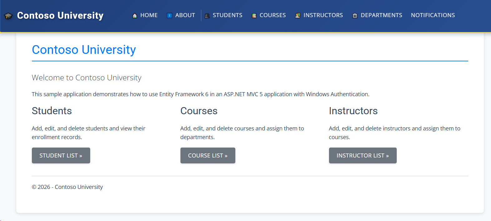

# Deploy ContosoUniversity (Legacy .NET) to Azure VM

Use the Terraform configuration and PowerShell setup script in this folder to deploy the **ContosoUniversity** ASP.NET MVC 5 / .NET Framework 4.8 application to a Windows Server 2022 Virtual Machine — the "before" state of the modernization journey.

## What Gets Deployed

| Component | Details |
|---|---|
| VM OS | Windows Server 2022 Datacenter |
| VM Size | `Standard_D2s_v3` (2 vCPU / 8 GB RAM) |
| Web Server | IIS with ASP.NET 4.x |
| Database | SQL Server Express 2019 (local, `.\SQLEXPRESS`) |
| Database browser | SQL Server Management Studio 22 (SSMS), installed automatically |
| Messaging | MSMQ (Windows Message Queuing) |
| App URL | `http://<public-ip>` |

## Prerequisites

- [Terraform](https://developer.hashicorp.com/terraform/install) ≥ 1.5
- [Azure CLI](https://learn.microsoft.com/cli/azure/install-azure-cli) — logged in (`az login`)
- An Azure subscription with permissions to create resource groups and VMs

## Deploy

> **Run all commands below from this folder:** `Student/Resources/dotnet/infra/`
> ```powershell
> cd Student/Resources/dotnet/infra
> ```

### 1. Create your variables file

```bash
cp terraform.tfvars.example terraform.tfvars
```

Edit `terraform.tfvars` and set:
- `admin_password` — must be 12+ characters with upper, lower, digit, and special character

> **Note:** At `terraform apply` time, Terraform calls `https://api.ipify.org` to detect your outbound public IP and automatically scopes the NSG RDP rule to that address. If your IP changes (e.g. after a network switch), re-run `terraform apply` to update the rule.

### 2. Initialise and apply

```bash
terraform init
terraform plan
terraform apply
```

Terraform will output:
- `public_ip` — the VM's public IP address
- `app_url` — `http://<public-ip>` (available after setup completes)
- `rdp_command` — RDP connection command

### 3. Wait for setup to complete

The `setup-contoso` VM Run Command runs `scripts/setup.ps1` automatically after the VM starts. It installs the following tools, then clones, builds, and deploys the application:
- Chocolatey, Git, NuGet CLI, SQL Server Express 2019
- IIS features + ASP.NET 4.x
- MSMQ
- Visual Studio 2022 Build Tools

After `setup-sql-dms` prepares SQL Express for migration, a separate `setup-ssms` Run Command runs `scripts/ssms.ps1`. It downloads the [official SSMS 22 installer](https://learn.microsoft.com/en-us/ssms/install/install) and installs it silently, waiting for completion without automatically rebooting the VM. It skips installation if the managed SSMS executable already exists.

**Allow at least 2 hours before the demo** for SQL Server, Build Tools, and SSMS downloads and installation. If SSMS reports that a reboot is required, reboot the VM before the demo and verify IIS and SQL Express are running.

For an **existing VM**, run `terraform plan` and `terraform apply` from its original deployment directory/backend/workspace. The added `setup-ssms` command does not require replacing the VM or rerunning the unchanged application setup. Review the plan before applying; do not use empty Terraform state for an existing deployment.

### 4. Verify the application

Open a browser and navigate to `http://<public-ip>`.

You should see the ContosoUniversity home page. On first load, the application creates the database schema automatically via `DbInitializer`.



## Connecting via RDP

```
mstsc /v:<public-ip>
```

Log in with:
- **Username:** the value of `admin_username` (default: `azureadmin`)
- **Password:** the value of `admin_password` from your `terraform.tfvars`

Open **SQL Server Management Studio** from the Start menu. Its managed executable is `C:\Program Files\Microsoft SQL Server Management Studio 22\Release\Common7\IDE\Ssms.exe`. For the demo walkthrough, connect to `tcp:localhost,1433` with SQL Authentication, login `dms_migration`, and your privately configured `sql_migration_password`. Trust the server certificate only for this local demo connection.

## Troubleshooting

### App setup failed or app not reachable

Check the VM Run Command status and output in Azure Portal:

```
Azure Portal → Virtual Machines → <vm-name> → Run command
→ setup-contoso / setup-sql-dms / setup-ssms
```

Or RDP into the VM and inspect:

```
C:\setup-contoso.log
C:\setup-ssms.log
```

### SQL Server service not running

From an RDP session:
```powershell
Get-Service -Name "MSSQL*"
Start-Service -Name "MSSQL$SQLEXPRESS"
```

### SSMS is missing or installation failed

Check the `setup-ssms` Run Command status in Azure Portal and inspect `C:\setup-ssms.log` on the VM. The Visual Studio installer writes detailed `dd_*` logs to the installing account's temporary directory (typically `C:\Windows\Temp` for the Run Command).

Resolve download access, disk space, or pending-reboot issues, then rerun `scripts/ssms.ps1` in an elevated PowerShell session on the VM. A missing executable or failed installer exit code fails the Run Command rather than reporting success.

### IIS application pool stopped

```powershell
Import-Module WebAdministration
Start-WebAppPool -Name "ContosoUniversity"
Start-Website -Name "ContosoUniversity"
```

## Clean Up

```bash
terraform destroy
```

This removes all Azure resources created by this configuration.
